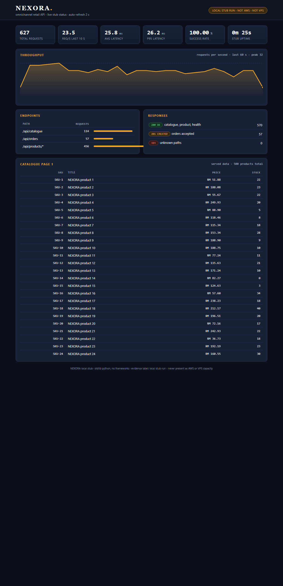

# NEXORA — Omnichannel Retail Cloud Transformation

**BIT4043 Cloud Architecturing · Final Assessment · Class Code 01-202609F0712 · City University Malaysia**

NEXORA is a fictional Malaysian omnichannel retailer (120 stores, 3 distribution centres, ~2,000 orders/day) used as an enterprise cloud-migration case study. Its legacy estate — one data centre, a 15-year-old monolith, disconnected store/online inventory databases, manual disaster recovery — produces one hero problem: **the last unit gets sold twice**.

This repository contains the **infrastructure code and the load-simulation harness** for our target AWS platform, plus the **measured results** of the simulation runs.

> **Honesty label.** The Terraform is a *prototype* — it has **not** been applied to a live AWS account. All load-test numbers are **local measured runs against the NEXORA API stub** (25 ms simulated latency). They describe the stub and harness under load — **not AWS capacity, autoscaling or multi-region failover**. The TCO is modelled from public list prices, not billing data.

---

## What's inside

```
├── iac/                       Terraform prototype + k6 load profiles
│   ├── main.tf                providers aliased: ap-southeast-5 (MY) · ap-southeast-3 (JKT)
│   ├── variables.tf           region, capacity, tagging inputs
│   ├── outputs.tf             ALB DNS, Aurora endpoints, dashboard URLs
│   ├── modules/
│   │   ├── networking/        VPC, subnets, IGW, NAT, routing (both regions)
│   │   ├── security/          ALB + app security groups, ECS task roles
│   │   ├── compute/           ALB, target group, Fargate service, target-tracking autoscaling
│   │   ├── data/              Aurora MySQL Global Database — writer MY, replica JKT
│   │   └── monitoring/        SNS ops topic, CPU alarm, log group
│   ├── normal-load.js         k6 profile: 20 VUs steady state
│   ├── peak-load.js           k6 profile: 20 → 200 VU campaign ramp
│   ├── spike-load.js          k6 profile: 20 → 400 VU sudden spike
│   ├── tco-analysis.md        3-year TCO model (on-prem vs cloud) with sensitivity + honesty rules
│   └── README.md              labelling rules for the IaC package
├── simulation/                runnable demo harness
│   ├── stub_api.py            stdlib-only NEXORA API stub + live dashboard at /
│   ├── run_with_stub.py       one command: stub + k6 + JSON summary export
│   ├── EVIDENCE.md            what each saved result file proves
│   ├── run-local.md           how to reproduce the runs
│   └── results/               the saved official runs (below)
└── docs/
    └── dashboard-live.png     live stub dashboard under real generated traffic
```

## Measured simulation results (26 Nov 2026)

| Profile | Load | Requests | Throughput | p95 | Failed | Result |
|---|---|---|---|---|---|---|
| Normal trading | 20 VUs · 10 min | 33,420 | 55.6 req/s | 27.3 ms | 4 of 33,420 | PASS |
| Campaign ramp | 20 → 200 VUs · 15 min | 329,484 | 365.4 req/s | 26.6 ms | 5 of 329,484 | PASS |
| Sudden spike | 20 → 400 VUs · 6 min | 191,721 | 514.5 req/s | 26.0 ms | 5 of 191,721 | PASS |

The handful of failed requests are **startup connection refusals** — catalogue requests fired before the stub began listening. All configured k6 thresholds passed in all three runs. Raw outputs: `simulation/results/*.txt` and `*.json`.



## Run it yourself

Prerequisites: [Python 3.10+](https://www.python.org/downloads/) and [k6](https://grafana.com/docs/k6/latest/set-up/install-k6/).

```bash
cd simulation
python run_with_stub.py ../iac/normal-load.js results/my-normal.json
```

That single command starts the stub (with its live dashboard at `http://127.0.0.1:8080/`), runs the k6 profile, and writes a machine-readable summary. Repeat with `peak-load.js` and `spike-load.js`. No cloud account, no dependencies — the stub is Python stdlib only.

To inspect the Terraform prototype:

```bash
cd iac
terraform init && terraform validate && terraform plan
```

(`terraform plan` requires AWS credentials; the prototype was never applied by design.)

## Architecture in one paragraph

Storefront traffic enters through Route 53 latency routing and AWS Global Accelerator into an ALB fronting ECS Fargate tasks (Graviton, target-tracking autoscaling) across three Availability Zones in **ap-southeast-5 (Malaysia)**. Orders and inventory run on **Aurora MySQL Global Database** — a single writer in Malaysia with an asynchronous replica in **ap-southeast-3 (Jakarta)**, promoted on regional failure (warm standby). The oversell fix is application-level: **conditional writes reserve stock** so two channels cannot both claim the last unit, and EventBridge→SQS events with **idempotency keys** plus a dead-letter queue and reconciliation job keep store and warehouse stock converged in near-real time. The retained ERP integrates through the event mesh (hybrid, deliberately temporary). Analytics replays S3 data-lake exports with Athena + QuickSight (pilot light).

## Recovery targets (design objectives, validated in DR drills)

| Workload | DR model | RTO | RPO |
|---|---|---|---|
| Storefront | Active-active across AZs; warm standby across regions | < 5 min | < 1 min |
| Orders / payment / inventory | Aurora Global warm standby | < 15 min | < 1 min |
| ERP | Warm standby | < 60 min | < 15 min |
| Analytics | Pilot light | < 4 h | < 1 h |

## Cost model (3-year, modelled)

| | On-premises | AWS target |
|---|---|---|
| 3-year TCO | $236,124 | $119,043 |
| | | **saving ≈ $117,000 (~50%), break-even month 5 after go-live** |

Built from AWS list prices (24 Nov 2026) with documented assumptions — including an assumed ~10% regional adjustment on Fargate — and a sensitivity row (2× traffic ≈ 48% saving; Aurora I/O-Optimized ≈ 47%; FinOps levers ≈ 52%). Full workings: [`iac/tco-analysis.md`](iac/tco-analysis.md).

## Security & compliance posture

Zero-trust VPC segmentation with public/private subnet zoning; security groups chained per tier on named ports; no inbound management ports (SSM Session Manager instead of SSH); AWS WAF + Shield **Standard**; IAM Identity Center with MFA and least-privilege RBAC; TLS 1.3 in transit, KMS at rest, Secrets Manager; centralised CloudTrail with GuardDuty and Security Hub findings. Malaysia remains the primary customer-data environment; the Jakarta DR replica is treated as a **cross-border transfer under Section 129 of the PDPA 2010 (as amended 2024)** — documented assessment, safeguards, audited access. Encryption supports compliance; it does not replace the legal assessment.

## Team

| Member | Contribution |
|---|---|
| Islam Md Ashraful | HA/DR, oversell fix, security, PDPA, IaC, simulation · team lead |
| Atif Md | Requirements, 6R strategy, rollout plan, target architecture |
| Mahmud Husain | Business case, as-is audit, legacy analysis |
| Ashraf Abdalla Mohammed | TCO, FinOps, business value, risk register |

## License & attribution

Released for educational assessment purposes. NEXORA is a representative case study — not a real retailer. AWS service names are trademarks of Amazon Web Services. Built with [Grafana k6](https://k6.io) and [Terraform](https://www.terraform.io).
